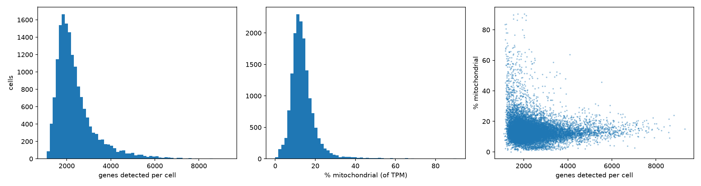
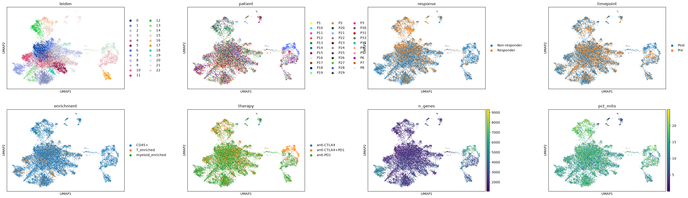
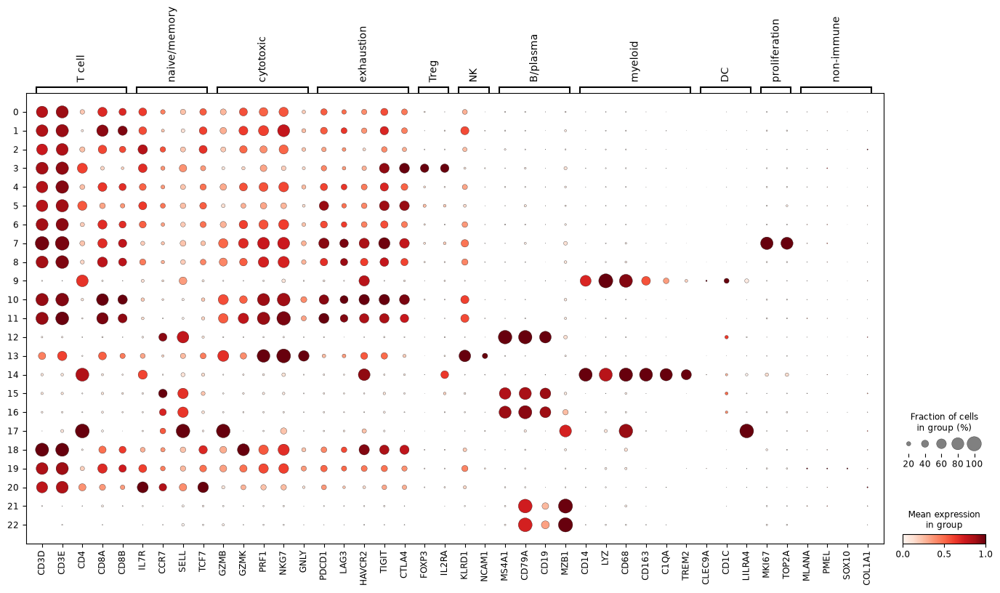
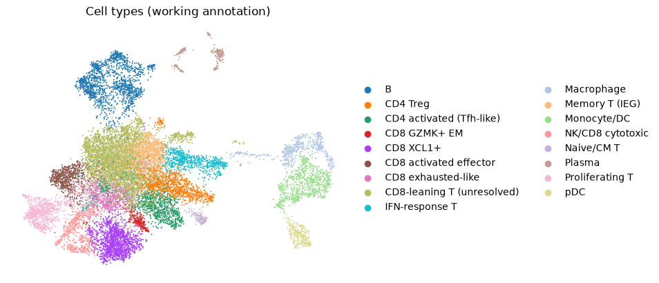
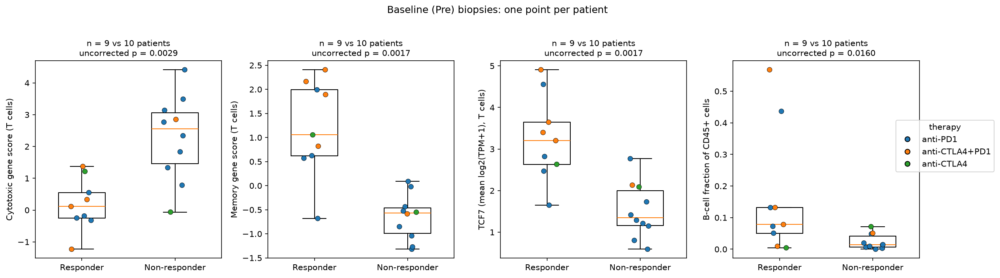

# scRNAseq-melanoma-analysis

Single-cell RNA-seq analysis of tumor-infiltrating immune cells from melanoma patients treated with checkpoint inhibitors (GEO [GSE120575](https://www.ncbi.nlm.nih.gov/geo/query/acc.cgi?acc=GSE120575); Sade-Feldman et al., *Cell* 2018), done in Python with [Scanpy](https://scanpy.readthedocs.io/).

The question: **which immune cell types or states are associated with response to checkpoint therapy?** The pipeline covers loading and QC, clustering, cell-type annotation, and patient-level response analyses. Every comparison uses the patient (not the cell) as the unit, and the conclusions are deliberately cautious. Please read the limitations section.

> **Status:** exploratory analysis of one public dataset (9 vs 10 patients at baseline). The main use of the project is the analysis workflow. The findings are hypotheses and should not be read as a validated biomarker.

## Data

| | |
|---|---|
| Cells | 16,291 CD45+ immune cells (Smart-seq2) |
| Biopsies / patients | 48 tumor biopsies from 32 patients |
| Therapy | 35 biopsies anti-PD1, 11 anti-CTLA4+PD1, 2 anti-CTLA4 |
| Timepoint | Pre (baseline) or Post (on treatment) |
| Response | Responder / Non-responder, as labelled in GEO (recorded per biopsy) |
| Sort fraction | unsorted CD45+ (15,300 cells), `T_enriched` (873), `myeloid_enriched` (118); the labels come from the matrix header. After clustering, most retained `myeloid_enriched` cells fall in B-cell and plasma clusters (72 of 107) and only 19 in Monocyte/DC or pDC clusters, so that label should not be taken at face value. Composition and score analyses use unsorted cells only. |
| Values | **log2(TPM + 1)**, not raw counts |

The matrix is already log-scaled (2^x - 1 sums to about 1,000,000 per cell), so the pipeline does **not** apply `normalize_total` or `log1p`. Baseline (Pre) has 9 responder and 10 non-responder patients (one Pre biopsy per patient). The two files used are the TPM matrix and the sample table from the GEO series page; `run_all.sh` downloads them.

## Pipeline

| Script | Purpose |
|---|---|
| `01_load_matrix.py` | Builds a sparse AnnData; attaches patient, timepoint, response, therapy and sort fraction (parsed from the matrix label suffix) |
| `02_qc_metrics.py` | Genes per cell and mitochondrial share (from back-transformed TPM) |
| `03_cluster.py` | Filters cells and genes, selects variable genes, PCA, neighbors, UMAP, Leiden clustering, marker genes |
| `04`-`07` (in `scripts/exploratory/`) | Exploratory diagnostics (cluster composition by biopsy and sort fraction, marker detection fractions). They hard-code Leiden cluster numbers from earlier runs, so they are kept for reference only and are not run by `run_all.sh` |
| `08_annotate.py` | Merges the 23 Leiden clusters into 17 cell-type labels |
| `09`, `10` | Per-patient cell-type fractions, responders vs non-responders, and a check of the hits |
| `11_patient_id_check.py` | Consistency of patient, timepoint, response and therapy labels |
| `12`, `13` | Gene-set scores per patient, responders vs non-responders, and sensitivity checks |
| `14_tcf7.py` | *TCF7* at baseline |
| `15_cluster_adjusted.py` | Gene-set scores adjusted for cell type |
| `16_robustness.py` | *TCF7* within anti-PD1 only; memory score without *TCF7* |
| `17_figures.py` | Figures: baseline patient-level comparisons and a UMAP colored by cell type |
| `check_labels.py` | Diagnostic: reconciles matrix and GEO labels; confirms the log2(TPM+1) scale |

### Processing choices

- **Cell filter:** removed cells with more than 25% of TPM in mitochondrial genes (782 of 16,291 cells; 15,509 remain). The deposited data appear to be pre-filtered (no cell has fewer than 1,093 detected genes), so no gene-count filter was applied. The mitochondrial fraction here is a share of TPM in sorted lymphocytes, and typical 10x thresholds do not apply; the cutoff is the upper Tukey fence of the distribution.
- **Genes:** kept genes detected in at least 3 cells (45,414 genes) and selected the 2,000 most variable genes (Seurat method). Two groups were then removed from that variable-gene set before PCA: T- and B-cell receptor variable, joining and diversity genes (239; clonotype signal, not cell state), and technical-noise genes (541, matched by name pattern: *MTRNR2L\**, *RN7S\**, clone-ID lncRNAs such as *RP11-* and *AC######.*, heat-shock genes *HSPA/HSPB/DNAJ*, and the immediate-early genes *FOS, FOSB, JUN, JUNB, JUND*), leaving about 1,220 genes. The removals apply only to the clustering input; gene scores and tests use all genes. Without them, clusters formed around clonotypes, the *MTRNR2L* signature of a few biopsies, and one biopsy's heat-shock response.
- **Embedding and clusters:** scaling (clipped at 10), PCA (50 components computed, 30 used), a 15-neighbor graph, UMAP, and Leiden clustering at resolution 0.8, all with a fixed seed. Clusters were annotated by hand from marker genes. The annotation in `08_annotate.py` is tied to the cluster numbers of this exact run.
- **Cell-type annotation:** 17 labels (CD4 Treg, CD4 activated (Tfh-like), CD8 exhausted-like, CD8 activated effector, CD8 GZMK+ EM, CD8 XCL1+, Proliferating T, Naive/CM T, Memory T (IEG), IFN-response T, NK/CD8 cytotoxic, Monocyte/DC, Macrophage, B, Plasma, pDC, and an unresolved group). A "CD8-leaning T (unresolved)" group holds 3,664 cells (24% of the cells), because CD4 and CD8 detection is unreliable in Smart-seq2.
- **Statistics:** one value per patient and timepoint, two-sided Mann-Whitney U tests, and Benjamini-Hochberg correction **within each block of tests** (16 cell types per timepoint for composition; 5 scores per analysis and timepoint for gene sets), not across all analyses. Only unsorted CD45+ cells are used for composition and scores. Cell-type fractions need at least 50 cells per biopsy, and scores at least 30 T cells per biopsy (20 in the CD8-leaning-only check, and 20 per patient for *TCF7*). Repeat biopsies (the `_2` labels) are averaged within patient and timepoint unless their response labels differ, in which case they stay as separate rows.

## Figures

<p align="center">
  
</p>
<p align="center"><em><strong>Figure 1.</strong> Quality control: genes detected per cell (left), mitochondrial share of TPM (middle), and the two plotted against each other (right).</em></p>

<p align="center">
  
</p>
<p align="center"><em><strong>Figure 2.</strong> UMAP of the 15,509 cells that passed QC, colored (left to right, top to bottom) by Leiden cluster, patient, response, timepoint, sort fraction, therapy, genes per cell and mitochondrial share. Cells from one patient are not independent, so patterns in the response panel are not evidence on their own; all tests use patient-level values.</em></p>

<p align="center">
  
</p>
<p align="center"><em><strong>Figure 3.</strong> Marker genes by Leiden cluster. Dot size is the fraction of cells expressing the gene; color is mean expression, scaled per gene.</em></p>

<p align="center">
  
</p>
<p align="center"><em><strong>Figure 4.</strong> UMAP colored by the working cell-type annotation (17 labels).</em></p>

<p align="center">
  
</p>
<p align="center"><em><strong>Figure 5.</strong> Baseline (Pre) responders vs non-responders, one point per patient and colored by therapy: cytotoxic and memory gene scores (T cells), <em>TCF7</em> (T cells) and B-cell fraction. The p-values printed on the plots are uncorrected.</em></p>

## Results

All tests below compare responders with non-responders within a timepoint. Baseline (Pre) is the only comparison that speaks to *prediction*; Post biopsies are taken on treatment, so Post differences reflect the response state.

### Annotation findings

- No melanoma-cell contamination: *MLANA*, *PMEL* and *SOX10* are detected in 0-4% of cells in every cluster.
- The macrophage cluster is dominated by one patient: 371 of its 523 cells come from P28 (320 from biopsy Post_P28, whose cells are themselves about 90% macrophage, plus 51 from Post_P28_2). Plasma cell clusters are patient-specific and clonal (immunoglobulin genes). These clusters were not interpreted as response-related findings.
- Best-supported labels: myeloid, B, plasma, pDC, Treg, exhausted-like and cytotoxic. The unresolved CD8-leaning group is the weakest.
- Lineage markers are patchy in Smart-seq2: *CD4* is detected in only 56-63% of cells in the clearest CD4 clusters (Treg, Tfh-like) and *CD8A* in 75-78% of cells in the clearest CD8 clusters (XCL1+, exhausted-like, activated effector). The four unresolved clusters detect *CD8A* in 54-58%, *CD8B* in 39-43% and *CD4* in 20-25% of cells, so they lean CD8 but are mixed. *CD4* is also detected in 78-97% of cells in the monocyte, macrophage and pDC clusters, which are known to express it.

### Cell-type composition (per-patient fractions of unsorted CD45+ cells)

Fractions are shares of all unsorted CD45+ cells in a biopsy (T, B, myeloid and other cells together), computed after removing the one-patient macrophage cluster. They are compositional, so a rise in one cell type lowers the others.

- **Pre (9 vs 10 patients):** Naive/CM T cells were higher (median 2.7% vs 0.3% of cells) and Proliferating T cells lower (2.1% vs 4.8%) in responders, both at FDR 0.039 across 16 cell types. Neither holds within anti-PD1 alone (4 vs 8 patients, uncorrected p = 0.13 and 0.07), and Naive/CM T is a very small population (at most 5% of cells in any patient). B cells (7.8% vs 1.4%), monocytes/DC (0.9% vs 9.5%) and pDC (0.6% vs 1.8%) are borderline (FDR 0.069 each). Two responders (P26 and P35) have extreme B-cell fractions (57% and 44%), but the B-cell difference also appears within anti-PD1 alone (4 vs 8 patients, uncorrected p = 0.004, with all four responders above all eight non-responders). I do not consider any of these established.
- **Post (8 vs 18 patients):** IFN-response T (1.2% vs 3.8%) and Proliferating T (1.0% vs 5.3%) were lower in responders (FDR 0.067 each across 16 cell types); within anti-PD1 alone (5 vs 16 patients) the uncorrected p-values are 0.025 and 0.043. Post values reflect response, not prediction.

### Gene-set scores at baseline (T cells, patient-level; 9 responders vs 10 non-responders)

Scores use `scanpy.tl.score_genes` with fixed gene sets: memory (*TCF7, IL7R, CCR7, SELL, LEF1*), exhaustion (*PDCD1, LAG3, TIGIT, HAVCR2, CTLA4, CXCL13*), cytotoxic (*GZMB, PRF1, NKG7, GNLY, GZMH*), proliferation (*MKI67, TOP2A, STMN1, TUBB, RRM2*) and interferon (*ISG15, IFI6, IFIT1, IFIT3, MX1, RSAD2, IFI44L*). "Cluster-adjusted" subtracts each cell's cell-type mean score (the mean over all included cells of that type, pooled across patients), so the comparison reflects differences *within* cell types and not shifts in their proportions. Adjusted medians are therefore residuals, where 0 means "typical for that cell type".

| Score | Higher in | FDR, raw | FDR, cluster-adjusted | FDR, adjusted, CD8-labelled clusters (9 v 9) | Adjusted, anti-PD1 only (4 v 8): p / FDR |
|---|---|---|---|---|---|
| Cytotoxic | non-responders | 0.006 | 0.009 | 0.005 | 0.004 / 0.020 |
| Memory | responders | 0.006 | 0.009 | 0.005 | 0.049 / 0.121 |
| Exhaustion | non-responders | 0.016 | 0.033 | 0.027 | 0.154 / 0.256 |
| Proliferation | non-responders | 0.006 | 0.046 | 0.158 | 0.570 / 0.570 |
| Interferon | non-responders | 0.079 | 0.046 | 0.027 | 0.283 / 0.354 |

- **Most robust:** lower cytotoxic-gene scores in responders' baseline T cells. It holds after cell-type adjustment and within anti-PD1-treated patients alone.
- **Consistent in direction but weaker under restriction:** higher memory score and lower exhaustion score in responders. Memory is borderline within anti-PD1 only.
- **Fragile or compositional:** proliferation (largely a Proliferating-T-cluster effect) and interferon (changes significance depending on the analysis).
- **Post (exploratory):** the interferon score is lower in responders (FDR 0.021 cluster-adjusted; 0.097 within anti-PD1 only); proliferation differences disappear after cell-type adjustment.

### *TCF7*

The original publication reported *TCF7* in CD8 T cells as associated with a positive outcome. This project reuses the same dataset, so the result below is a **reproduction, not an independent replication**, and the memory score contains *TCF7*.

| Baseline test (patient-level, unsorted CD45+ T cells) | n (R v NR) | median R v NR | p (uncorrected) |
|---|---|---|---|
| Mean *TCF7*, all T cells | 9 v 10 | 3.20 v 1.35 | 0.0017 |
| Fraction of cells with *TCF7* detected | 9 v 10 | 0.48 v 0.21 | 0.0022 |
| Mean *TCF7*, CD8-leaning (unresolved) cells | 9 v 9 | 3.05 v 1.29 | 0.0081 |
| Mean *TCF7*, all T, anti-PD1 only | 4 v 8 | 2.64 v 1.25 | 0.0283 |
| Mean *TCF7*, CD8-leaning, anti-PD1 only | 4 v 8 | 2.88 v 1.21 | 0.0727 |

The memory score recomputed **without *TCF7*** (*IL7R, CCR7, SELL, LEF1*) is still higher in responders at baseline (p = 0.0017 raw, 0.0037 cluster-adjusted; p = 0.049 within anti-PD1 only), so the signal is not carried by *TCF7* alone. Within anti-PD1 patients the evidence is borderline and, if the *TCF7* tests are treated as one family, would not survive multiple-testing correction.

## Limitations

- **Small sample:** 9 vs 10 patients at baseline, 4 vs 8 within anti-PD1 only, and 8 vs 18 at Post. Cells from one patient are not independent, so all tests use patient-level values.
- **Response is recorded per biopsy.** Four patients (P1, P4, P5, P28) carry different response labels at different biopsies, and P1 and P5 have opposite labels at two Post biopsies, so they appear in both groups at Post. Therapy is also recorded per biopsy: P1 and P6 were on anti-CTLA4 at baseline and anti-PD1 at their Post biopsy.
- **Soft lineage calls:** about a quarter of cells are in an unresolved CD8-leaning group, and CD4/CD8 detection is weak in Smart-seq2. The "CD8-labelled" analyses include this group.
- **Partial circularity:** several gene sets overlap with marker genes used to annotate clusters (for example exhaustion and interferon genes), which is why cell-type-adjusted tests were added.
- **Smart-seq2 TPM data** rather than counts: count-based models were not used.

## Reproduce

```bash
conda env create -f environment.yml
conda activate scrna
bash run_all.sh            # downloads the two GEO files, then runs the numbered scripts and writes logs/
```

The annotation step maps cluster numbers to labels, so it depends on the exact versions in `environment.yml` and on the fixed seeds. `08_annotate.py` checks the cluster sizes against the reference run and stops with an error if they differ, because its cluster-to-label mapping would then be wrong; in that case the annotation has to be redone by hand. Results tables are written to `results/` and figures to `docs/figures/`. Large intermediate files (`data/`, `*.h5ad`) are not committed.

**Version notes.** Scanpy 1.11.5, anndata 0.12.19, SciPy 1.16.3, NumPy 2.4.6, pandas 2.3.3, statsmodels 0.15.0, leidenalg 0.12.0, python-igraph 1.0.0, Python 3.11. With this Scanpy version, `getnnz` was missing on SciPy's `csr_array`, which caused a crash; `03_cluster.py` contains a small shim for it. It is a workaround, and I did not find which package produces the `csr_array`. Scanpy also warns that the default Leiden implementation will change in a future release; the pinned version keeps the clustering stable.

## Reference

Sade-Feldman M, et al. Defining T cell states associated with response to checkpoint immunotherapy in melanoma. *Cell* 2018. Data: GEO GSE120575.

## License

MIT (see `LICENSE`).